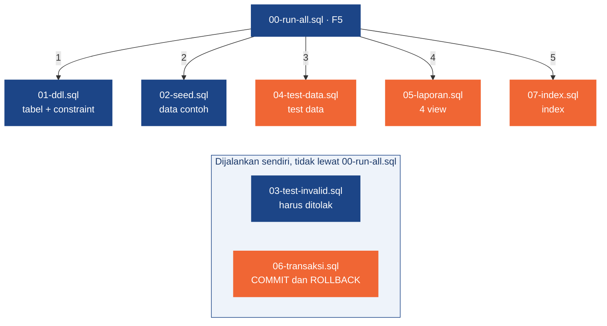

# Lab · Tahap 3 Project: Laporan, Transaksi, dan Index

[Persiapan](../README.md) · [Troubleshooting](../TROUBLESHOOTING.md)

**Skenario.** Database kelompok dari Lab sesi 22 akan dipakai backend (sesi 25-36) dan dipresentasikan di sesi 24. Paket yang diminta: laporan untuk dashboard, query validasi yang bisa dijalankan kapan saja, satu proses bisnis yang aman sebagai transaksi, dan query paling sering dipakai aplikasi yang sudah dibantu index dengan bukti execution plan. Contoh hasil akhirnya ditayangkan instruktur per bagian (laporan, plan, peta fitur); file contoh tidak dibagikan.

Satu anggota yang repo-nya sudah berisi hasil sesi 22 (`db/00` sampai `db/03`) mengerjakan di laptopnya, lalu di-push; anggota lain pull. Kelompok yang belum punya database dari sesi 22: bangun dulu minimal 3 tabel berelasi FK dari `db/01-ddl.sql` template, lalu kejar sisanya dengan pasangan anggota yang databasenya sudah jadi (copy `db/` lewat Git, jangan lewat chat).

Struktur file Tahap 3 (dari template repo kelompok):

| File | Isi | Masuk `00-run-all.sql` |
| --- | --- | --- |
| `db/04-test-data.sql` | Test data di tabel transaksi utama, penanda `UJI` | Ya |
| `db/05-laporan.sql` | Empat view: `<awalan>_LAP_RINGKASAN`, `<awalan>_LAP_TANPA_PASANGAN`, `<awalan>_CEK_VALIDASI`, `<awalan>_QUERY_UTAMA` | Ya |
| `db/06-transaksi.sql` | Proses bisnis dengan `COMMIT` dan skenario gagal `ROLLBACK` | Tidak (sengaja memicu error) |
| `db/07-index.sql` | Plan sebelum, `CREATE INDEX`, plan sesudah | Ya |

1. **Test data (`db/04-test-data.sql`).** Minimal 5.000 baris di tabel transaksi utama (disarankan 50.000), dengan penanda `UJI` di kode. **Sebar ke ±500 entity** (akun, pembeli, atau kurir test dengan kode `...-UJI-0001` dan seterusnya), bukan ke 10 entity: pola `CONNECT BY` dan `MOD(n, 500) + 1` seperti 515 rekening di Demo 3. Jalankan `DBMS_STATS.GATHER_TABLE_STATS` sesudahnya. Semua constraint tetap berlaku. Alasannya ada di bagian Test data dan index di bawah.
2. **Laporan (`db/05-laporan.sql`).** Buat empat view dengan nama persis di atas: `LAP_RINGKASAN` (`JOIN` minimal 2 tabel kelompok + `GROUP BY`, filter data `SIM` supaya test data tidak ikut), `LAP_TANPA_PASANGAN` (`LEFT JOIN` atau `NOT EXISTS`, minimal 1 baris), `CEK_VALIDASI` (hanya baris yang melanggar aturan; data sehat = 0 baris), dan `QUERY_UTAMA` (query yang paling sering dipakai aplikasi, `WHERE` berisi filter `=` dan rentang waktu). Buktikan validasinya: rusak satu data, hitung lagi, `ROLLBACK`.
3. **Transaksi (`db/06-transaksi.sql`).** Satu proses bisnis tema kelompok, minimal 2 perintah DML: skenario berhasil dengan `COMMIT`, skenario gagal yang di-`ROLLBACK`, dengan `SELECT` sebelum dan sesudah. `CEK_VALIDASI` tetap 0 baris setelahnya.
4. **Index (`db/07-index.sql`).** Catat plan `QUERY_UTAMA` sebelum index, buat index composite berawalan kelompok (kolom filter `=` dulu, lalu kolom waktu), catat plan sesudahnya. Operation harus berubah dari `TABLE ACCESS FULL` ke `INDEX RANGE SCAN`.
5. **`00-run-all.sql`.** Panggil `01`, `02`, `04`, `05`, `07` (06 tidak). Jalankan dua kali berturut-turut tanpa error.
6. **Cek otomatis.** Buka `cek-lab.sql` sesi 23 (folder `lab` di repo `dev-sesi-23`, atau folder `challenge` di ZIP lab sesi 23), ganti awalan di baris `DEFINE awalan = 'GRD'` dengan awalan kelompok (huruf besar, tanpa garis bawah), pasang koneksi, tekan **F5**. Output berupa tabel poin otomatis (maks. 80). Perbaiki file `db/` kelompok, bangun ulang, cek lagi. Jalankan juga `cek-erd.py` (sesi 21) dan `cek-lab.sql` sesi 22 untuk bukti.
7. **README repo kelompok.** Isi bagian **Peta fitur → tabel → query** (satu baris per fitur MVP, kolom endpoint usulan), **Laporan untuk dashboard** (hasil `LAP_RINGKASAN` ringkas dan tiga view lain), **Pertanyaan bisnis** (3 pertanyaan yang dijawab view atau query kelompok), dan **Bukti cek** (tempel baris `Subtotal otomatis` ketiga cek serta cost plan sebelum dan sesudah). Hapus semua `TODO`.
8. **Push** ke repo kelompok. Semua harus siap sebelum presentasi sesi 24 pukul 16.00 (pakai jeda siang) dan dinilai langsung di kelas; push final 23.59 hanya untuk serah terima ke pengajar backend.

Instruktur menayangkan contoh hasil akhir di layar (view, plan sebelum/sesudah index, dan output cek); filenya tidak dibagikan.

Struktur `db/` di repo kelompok (oranye = diisi di Lab 23, biru = sudah ada dari Lab 22):

## Test data dan index

Hasil test pada contoh: 6.000 baris yang disebar ke 10 entity membuat optimizer tetap memilih full scan, jadi index tidak terpakai dan kriteria plan di `cek-lab.sql` bernilai 0. Dengan 50.000 baris di 500 entity, optimizer memakai `INDEX RANGE SCAN` pada index kelompok. Jadi ukuran tabel saja tidak cukup: tiap entity harus punya baris sedikit dibanding total, supaya filter `=` + rentang waktu memang selektif.

## Rubrik Lab (100 poin)

Rubrik ini panduan kerja kelompok; nilai project diberikan saat presentasi sesi 24 (lihat Persiapan Presentasi).

| Kriteria | Poin | Dinilai oleh | Indikator keberhasilan |
| --- | --- | --- | --- |
| Laporan ringkasan | 20 | `cek-lab.sql` | `LAP_RINGKASAN` berisi minimal 1 baris (8), membaca minimal 2 tabel tim (6), memakai `GROUP BY` (6) |
| Laporan tanpa pasangan | 10 | `cek-lab.sql` | `LAP_TANPA_PASANGAN` minimal 1 baris (4), 2 tabel tim (3), `LEFT JOIN` atau `NOT EXISTS` (3) |
| Query validasi | 10 | `cek-lab.sql` | `CEK_VALIDASI` membaca tabel tim (5) dan menghasilkan 0 baris pada data sehat (5) |
| Test data | 10 | `cek-lab.sql` | Tabel tim terbesar minimal 5.000 baris (10), atau minimal 1.000 baris (5) |
| Index buatan tim | 10 | `cek-lab.sql` | Index di tabel tim di luar index PK/`UNIQUE`: composite (10), satu kolom (5) |
| Query utama + plan | 20 | `cek-lab.sql` | `QUERY_UTAMA` memakai `WHERE` dan berisi minimal 1 baris (5); plan memakai index buatan tim lewat range atau unique scan (15) |
| Transaksi | 10 | Review tim lain | Proses bisnis minimal 2 DML dengan `COMMIT` (5); skenario gagal di-`ROLLBACK` dan data terbukti kembali (5) |
| Bukti before/after | 5 | Review tim lain | Tabel operation dan cost (plus Buffers bila 3.0 sudah dijalankan) sebelum dan sesudah index |
| Bukti validasi | 5 | Review tim lain | Data sengaja dirusak, `CEK_VALIDASI` menampilkannya, `ROLLBACK`, kembali 0 baris |
| **Total** | **100** | | |

Prioritas: kerjakan dulu kriteria wajib: laporan ringkasan (20), query validasi (10), index buatan tim (10), query utama + plan (20) = 60 poin. Target minimal 60 poin.

`cek-lab.sql` membaca katalog, menjalankan `SELECT` pada view kelompok, dan membuat plan `QUERY_UTAMA`. Baris plan milik script dibatalkan lagi (`ROLLBACK TO SAVEPOINT`), jadi data dan transaksi yang belum di-commit tidak berubah.

## Bonus Lab (opsional, maks. +10)

1. (+5) Jalankan query utama tim dari Java atau Node.js: salin `Main.java` atau `mutasi.mjs`, ganti SQL-nya, kirim nilai filter lewat bind variable, password tetap dari environment variable. Jalankan juga dengan nilai berisi `' OR '1'='1` dan catat hasilnya.
2. (+5) Tambah satu view `<awalan>_LAP_PERSENTASE`: porsi tiap kelompok terhadap total (subquery di dalam `ROUND`, seperti Tantangan tambahan Demo 1).

## Persiapan Presentasi (sesi 24, 16.00-17.00)

Tiap kelompok tampil 5 menit presentasi + 3 menit tanya jawab, tanpa slide. README repo kelompok menjadi alur bicara dan demo dijalankan langsung di VS Code dari laptop salah satu anggota. **Urutan presentasi diumumkan di akhir sesi 23.** Pergantian kelompok dilakukan saat tanya jawab: kelompok berikutnya menyiapkan laptop, membuka VS Code, dan memasang koneksi selagi kelompok sebelumnya menjawab pertanyaan.

Alur 5 menit:

1. Masalah, ide dan produk BNI yang dikaitkan, fitur MVP (30 detik).
2. ERD: entity pusat, relasi, tabel user + role, satu aturan data penting dengan alasan bisnis.
3. Demo langsung: `00-run-all.sql` jalan, satu perintah dari `03-test-invalid.sql` ditolak (kode ORA), view `<awalan>_LAP_RINGKASAN` tampil.
4. Peta fitur → tabel → query: 2-3 endpoint pertama untuk backend.

Checklist sebelum presentasi:

- [ ] `00-run-all.sql` jalan dua kali berturut-turut tanpa error, di laptop yang dipakai presentasi.
- [ ] ERD punya tabel user + role; ERD dan kamus sama dengan tabel di database.
- [ ] `03-test-invalid.sql` minimal 3 perintah ditolak, kode ORA dicatat di komentar.
- [ ] Empat view Lab 23 ada; `<awalan>_CEK_VALIDASI` 0 baris.
- [ ] Bagian "Bukti cek" terisi (ketiga skor dan plan sebelum/sesudah).
- [ ] Semua bagian `TODO` di README terisi.

Yang dinilai (project 100 poin, dinilai di kelas):

| Komponen | Poin | Yang ditunjukkan |
| --- | --- | --- |
| A. ERD + kamus data | 25 | ERD, skor `cek-erd.py`, entity sesuai fitur MVP, tabel user + role, satu aturan data dan alasannya |
| B. Database | 35 | `00-run-all.sql` live, skor `cek-lab.sql` sesi 22, satu input salah ditolak dengan kode ORA, data contoh masuk akal |
| C. Laporan + kesiapan backend | 15 | `<awalan>_LAP_RINGKASAN` tampil dengan data, peta fitur mencakup tiap fitur MVP, 2-3 endpoint pertama |
| D. Penyampaian | 25 | Masalah, ide dan produk BNI → data runtut, selesai 5 menit, tanya jawab dijawab dengan data atau query |

Repo pukul 23.59 hanya untuk serah terima ke pengajar backend.
